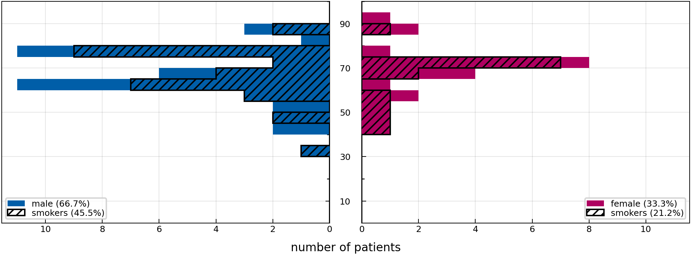
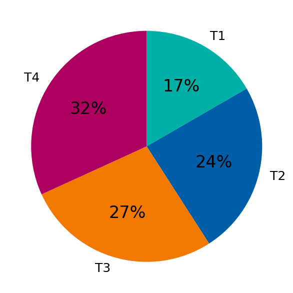
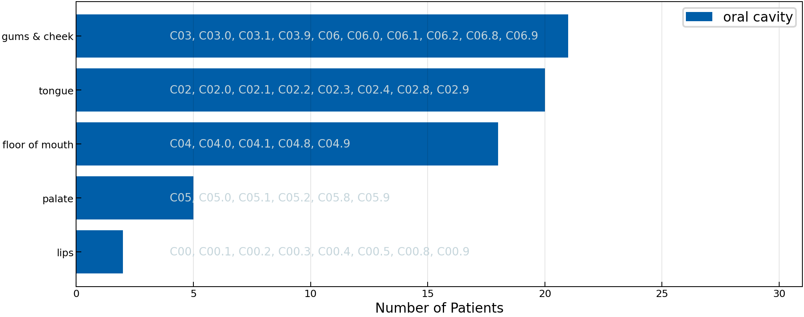

# 2025 KSA Oral cavity

[](https://doi.org/10.5281/zenodo.18231357)

This folder contains data about clinically and pathologically diagnosed lymphatic patterns of progression from 66 patients treated at the [Kantonsspital Aarau] between 2016 and 2023.

[Kantonsspital Aarau]: https://www.ksa.ch/de

## Table of Contents

- [Cohort Characteristics](#cohort-characteristics)
- [Curation](#curation)
- [Online Interface](#online-interface)
- [Data Description](#data-description)
- [Documentation of Columns](#documentation-of-columns)
- [Mapping Documentation](#mapping)

<a id="cohort-characteristics"></a>

## Cohort Characteristics

Below we show some figures that aim to coarsely characterize the patient cohort in this directory.

|                                |
| ---------------------------------------------------------------------------- |
| **Figure 1:** *Distribution over age, stratified by sex and smoking status.* |

|  |              |
| -------------------------------------------------- | -------------------------------------------------------- |
| **Figure 2:** *Distribution over T-category.*      | **Figure 3:** *Distribution over primary tumor subsite.* |

<a id="online-interface"></a>

## Online Interface

We provide a user-friendly and intuitive graphical user interface to view the dataset, which is available at <https://lyprox.org/>. The GUI has two main functionalities: the patient list and the dashboard. The patient list allows for viewing the characteristics of a patient, corresponding to one row of the csv file, in a visually appealing and intuitive way. The dashboard allows for filtering of the dataset. For example, the user may select all patients with primary tumors extending over the mid-sagittal plane with involvement of ipsilateral level III. The dashboard will then display the number or percentage of patients with metastases in each of the other LNLs.

<a id="data-description"></a>

## Data Description

The data is provided as a CSV-table containing one row for each of the 66 patients. The table has a header with three levels that describe the columns. Below we explain each column in the form of a list with three levels. So, for example, list entry 1.i.g refers to a column with the three-level header `patient | core | alcohol_abuse` and underneath it we report each patient's history of alcohol abuse.

<a id="documentation-of-columns"></a>

## Documentation of Columns

1. **`patient:`** This top-level header contains general patient information.
    1. **`core:`** The second level header for the 'patient' columns is only a placeholder.
        1. **`id:`** The patient ID.
        2. **`institution:`** Institution where the patient was treated
        3. **`sex:`** The biological sex of the patients.
        4. **`age:`** Age of the patient at the time of diagnosis
        5. **`weight:`** The weight of the patient at the time of diagnosis.
        6. **`diagnose_date:`** The date of diagnosis.
        7. **`alcohol_abuse:`** Whether the patient was abusingly drinking alcohol at the time of diagnosis.
        8. **`nicotine_abuse:`** Whether the patient was smoking nicotine at the time of diagnosis.
        9. **`hpv_status:`** The HPV p16 status of the patient.
        10. **`neck_dissection:`** Whether the patient underwent a neck dissection.
        11. **`tnm_edition:`** The edition of the TNM classification used.This information is not available in this dataset.
        12. **`n_stage:`** The N category of the patient.
        13. **`m_stage:`** The M category of the patient. `-1` refers to `'X'`.
        14. **`extracapsular:`** Whether the patient had extracapsular spread. In this dataset, this information is only globally available, not for each individual lymph node level.
2. **`tumor:`** This top-level header contains general tumor information.
    1. **`core:`** The second level header enumerates synchronous tumors.
        1. **`location:`** The location of the tumor.
        2. **`subsite:`** The subsite of the tumor, specified by ICD-O-3 code.
        3. **`side:`** Whether the tumor occurred on the right or left side of the mid-sagittal plane.
        4. **`central:`** Whether the tumor is located centrally w.r.t. the mid-sagittal plane.
        5. **`extension:`** Whether the tumor extended over the mid-sagittal line.
        6. **`distance_midline:`** The distance of the primary tumor to the mid-sagittal plane in mm.
        7. **`volume:`** The volume of the tumor in cm^3.
        8. **`t_stage_prefix:`** The prefix of the T category.
        9. **`t_stage:`** The T category of the tumor.
3. **`diagnostic_consensus:`** This top-level header contains information about the diagnostic consensus.
    1. **`core:`** This second-level header contains general information.
        1. **`date:`** The date of the diagnostic consensus (same as neck dissection date).
    2. **`ipsi:`** This reports the diagnostic consensus of the ipsilateral LNLs.
        1. **`Ib:`** E.g., this column reports the diagnostic consensus of the ipsilateral LNL Ib.
    3. **`contra:`** This reports the diagnostic consensus of the contralateral LNLs.
        1. **`III:`** Under this column, we report the diagnostic consensus of the contralateral LNL III.

---

<a id="mapping"></a>

## <kbd>module</kbd> `mapping`

Map the `raw.csv` data from the 2025-ksa-oral-cavity cohort to the `data.csv` file.

This module defines how the command `lyscripts data lyproxify` (see [the documentation](https://lyscripts.readthedocs.io/latest/) of the `lyscripts` module) should handle the `raw.csv` data that was extracted at the Kantonsspital Aarau in order to transform it into a [LyProX](https://lyprox.org)-compatible `data.csv` file.

The most important definitions in here are the list `EXCLUDE` and the dictionary `COLUMN_MAP` that defines how to construct the new columns based on the `raw.csv` data. They are described in more detail below:

---

### <kbd>global</kbd> `EXCLUDE`

List of tuples specifying which function to run for which columns to find out if patients/rows should be excluded in the lyproxified `data.csv`.

The first element of each tuple is the flattened multi-index column name, the second element is the function to run on the column to determine if a patient/row should be excluded:

```python
EXCLUDE = [
     (column_name, check_function),
]
```

Essentially, a row is excluded, if for that row `check_function(raw_data[column_name])` evaluates to `True`.

More information can be found in the [documentation](https://lyscripts.readthedocs.io/latest/data/lyproxify.html#lyscripts.data.lyproxify.exclude_patients) of the `lyproxify` function.

---

### <kbd>global</kbd> `COLUMN_MAP`

This is the actual mapping dictionary that describes how to transform the `raw.csv` table into the `data.csv` table that can be fed into and understood by [LyProX](https://lyprox.org).

See [the documentation](https://lyscripts.readthedocs.io/latest/data/lyproxify.html#lyscripts.data.lyproxify.transform_to_lyprox) for details on how this dictionary is used by the `lyproxify` script.

It contains a tree-like structure that is human-readable and mimics the tree of multi-level headers in the final `data.csv` file. For every column in the final `data.csv` file, the dictionary describes from which columns in the `raw.csv` file the data should be extracted and what function should be applied to it.

It also contains a `__doc__` key for every sub-dictionary that describes what the respective column is about. This is used to generate the documentation for the `README.md` file of this data.

---

**Global Variables**
---------------

- **TNM_COLS**
- **EXCLUDE**
- **COLUMN_MAP**

---

### <kbd>function</kbd> `smpl_date`

```python
smpl_date(entry: str) → str
```

Parse date from string.

---

### <kbd>function</kbd> `robust`

```python
robust(func: collections.abc.Callable) → Any | None
```

Return 'robust' type-conversion function.

Do so by simply returning `None` whenever any exception is thrown.

---

### <kbd>function</kbd> `clean_cat`

```python
clean_cat(cat: str) → int
```

Extract T or N category as integer from the respective string.

I.e., turn 'pN2+' into 2.

---

### <kbd>function</kbd> `get_tnm_info`

```python
get_tnm_info(ct, cn, pt, pn) → tuple[int, int, str]
```

Determine the TNM edition used.

---

### <kbd>function</kbd> `get_t_category`

```python
get_t_category(*args, **_kwargs) → int
```

Extract the T-category.

---

### <kbd>function</kbd> `get_n_category`

```python
get_n_category(*args, **_kwargs) → int
```

Extract the N-category.

---

### <kbd>function</kbd> `get_tnm_prefix`

```python
get_tnm_prefix(*args, **_kwargs) → str
```

Extract the TNM prefix.

---

### <kbd>function</kbd> `get_m_category`

```python
get_m_category(cat: str) → int
```

Extract M category as integer from the respective string.

I.e., turn 'CM0' into 0. `-1` refers to `'X'`.

---

### <kbd>function</kbd> `extract_hpv`

```python
extract_hpv(
    value_hpv: int,
    value_p16: int | None,
    *_args,
    **_kwargs
) → bool | None
```

Translate the HPV or p16 value (if HPV not available) to a boolean.

---

### <kbd>function</kbd> `get_side`

```python
get_side(entry: str) → str | None
```

Extract on which side of the mid-sagittal plane the tumor is located.
